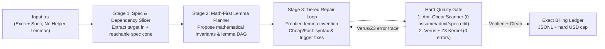

# lemma-zero

> **Math-First, Cost-Accounted Formal Proof Synthesis for Real-World Rust Systems (Verus) — With Zero Human-Provided Helper Lemmas.**

Modern LLM coding agents can fill in mechanical proof lines when human experts already hand them the right helper lemmas. Strip those lemmas away (`VeruSAGE-Bench` `tasks-no-lemma`, 460 repository-level Rust systems tasks), and SOTA agents collapse below ~41% on hard distributed/OS systems while burning 7–15+ minutes and \$5–\$30 per task.

**`lemma-zero`** attacks the **No-Lemma Cliff** directly by combining:
1. **Rust/Verus Spec & Dependency Slicing** — trimming ~950-LoC systems files down to the exact reachable spec cone to eliminate the ~150:1 context-reload tax.
2. **Math-First Lemma & Invariant Planning** — discovering the mathematical object, inductive invariant, and helper lemma DAG *before* emitting proof syntax.
3. **Verus/Z3 Trace-Guided Repair + Tiered Token FinOps** — routing syntax/type repair to cheap fast models, reserving frontier reasoning for lemma synthesis, and accounting for every billed token (input, cache write, cache read, output, thinking) under a hard USD cap.

---

## Target Baselines (Verified from `microsoft/verus-proof-synthesis`, 2026-11-26)

Official leaderboard: https://microsoft.github.io/verus-proof-synthesis/ (`last_updated: 2026-01-21`).

| System | Model | Split | Solved | Rate | Avg Time | Avg Cost / Task | Hardest (`AC` Anvil Adv.) |
| :--- | :--- | :--- | ---: | ---: | ---: | ---: | ---: |
| `VeruSAGE (Hands-off)` | Sonnet 4.5 | Full 849 (with lemmas) | 687 / 849 | 80.9% | 7.2 min | \$5.61 | 23 / 63 (36.5%) |
| `VeruSAGE (Hands-on)` | Sonnet 4.5 | Full 849 (with lemmas) | 573 / 849 | 67.5% | 6.9 min | \$1.47 | 23 / 63 (36.5%) |
| `VeruSAGE (Hands-off)` | Sonnet 4 | Full 849 (with lemmas) | 544 / 849 | 64.1% | 9.2 min | \$6.65 | 15 / 63 (23.8%) |
| `VeruSAGE (Hands-on)` | GPT-5 | Full 849 (with lemmas) | 479 / 849 | 56.4% | 12.7 min | \$0.52 | 17 / 63 (27.0%) |
| **`tasks-no-lemma.jsonl`** | **Open Frontier** | **460 no-lemma tasks** | **No leaderboard entries yet** | — | — | — | **58 tasks (`AC`)** |

---

## Architecture Overview



---

## Two-Phase Roadmap

- **Phase 1 — Empirical Proof of Rigor (`VeruSAGE-Bench` `tasks-no-lemma`):**
  1. Freeze pre-registration split (dev slice vs. stratified held-out slice from the 431 standalone no-lemma tasks + optional `ST` storage tasks).
  2. Build and ablate the 3-stage `lemma-zero` engine under strict USD caps and exact token accounting.
  3. Publish full reproducible artifacts, negative results, cost/solve Pareto curves, and submit an official PR to `microsoft/verus-proof-synthesis` leaderboard.
- **Phase 2 — Civilizational Upstream Proofs (Real Rust Infrastructure):**
  - Apply the proven engine to real unverified functions in production high-assurance Rust repositories such as [`Beneficial-AI-Foundation/dalek-verus`](https://github.com/Beneficial-AI-Foundation/dalek-verus) (`curve25519-dalek` used by Signal Messenger) and memory-safe parsers/systems crates.

---

## Repository Structure

| Path | Role |
| :--- | :--- |
| [`AGENTS.md`](AGENTS.md) | Scientific protocol, pre-registration discipline, anti-cheat contract, and hardware/budget guards. |
| [`docs/01-research-baseline.md`](docs/01-research-baseline.md) | Verified Step 0 audit of `VeruSAGE-Bench`, `tasks-no-lemma`, leaderboard baselines, and `dalek-verus`. |
| [`docs/02-architecture.md`](docs/02-architecture.md) | 3-stage engine design: Spec Slicer, Math-First Lemma Planner, Z3-Guided Tiered Repair & FinOps Router. |
| [`docs/03-preregistration-protocol.md`](docs/03-preregistration-protocol.md) | Pre-registration contract to lock before touching any held-out evaluation split. |
| [`config/experiment.json`](config/experiment.json) | Model pricing, tiered routing slots, timeouts, Verus binary config, and default `budget_cap_usd: 0.0` safety lock. |
| [`src/lemma_zero/anticheat.py`](src/lemma_zero/anticheat.py) | Deterministic anti-cheat & spec-preservation scanner (blocks `assume`, `admit`, `external_body`, spec weakening). |
| [`src/lemma_zero/ledger.py`](src/lemma_zero/ledger.py) | Exact token/cache/USD accounting ledger + hard spend-cap enforcer + Pareto summary generator. |
| [`src/lemma_zero/envcheck.py`](src/lemma_zero/envcheck.py) | Local toolchain & disk-budget (`>= 20 GB` floor) readiness checker. |
| [`src/lemma_zero/cli.py`](src/lemma_zero/cli.py) | Zero-dependency CLI (`env-check`, `check-anticheat`, `ledger-summary`). |
| [`tests/test_core.py`](tests/test_core.py) | Unit tests for anti-cheat vectors, exact cost accounting, budget caps, and CLI commands. |

---

## Quick Start (Day 0 Verification)

```bash
# Check local toolchain & 20 GB disk safety floor
PYTHONPATH=src python3 -m lemma_zero.cli env-check

# Run full unit test suite (anti-cheat, billing math, CLI)
PYTHONPATH=src python3 -m unittest discover -s tests -v

# Audit a candidate proof file against its original benchmark task
PYTHONPATH=src python3 -m lemma_zero.cli check-anticheat --original orig.rs --candidate cand.rs
```
