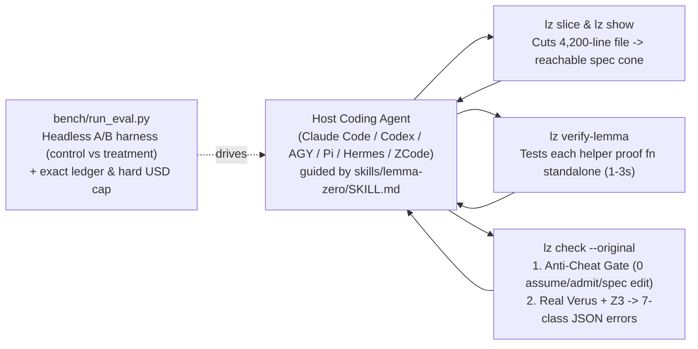

# 02 — Multi-Platform Plugin Architecture (`lemma-zero`)

## Design Principle: Do Not Reinvent the Coding Agent

Rather than wrapping raw LLM SDKs in a custom CLI (duplicating auth, prompt caching, tool calling, and agent loops), **`lemma-zero` ships as a portable multi-platform agent plugin**:
- **Host Agent Layer (Claude Code, Codex, Antigravity, Pi, Hermes, ZCode):** owns frontier reasoning, subscription/API billing, KV caching, file edits, and automatic upgrades whenever stronger base models release (`model_update_survival = amplified`).
- **Deterministic Local Verifier Engine (`scripts/lz.py`, stdlib-only Python, 0 LLM calls):** owns all precision mechanics that raw agents are bad at — dependency slicing, structured Verus/Z3 error parsing, isolated single-lemma verification, anti-cheat gating, and exact cost/solve accounting.
- **Portable Math-First Skill (`skills/lemma-zero/SKILL.md`):** injects the exact 4-step protocol that solves the No-Lemma Cliff.

---

## Data Flow Inside Any Host Coding Agent

---

## Core Engine Modules (`src/lemma_zero/`)

1. **`slicer.py` — Reachable Spec-Cone Slicer**
   - Real `tasks-no-lemma.jsonl` files reach **4,237 lines (~155 KB / ~40k tokens)** (`AC__vreplicaset_controller...`).
   - Indexes top-level Verus items and `impl` methods with exact 1-based line ranges, runs bounded BFS over referenced identifiers from `target_function`, and cuts context by **70%–95%** while letting the agent pull any omitted symbol on demand via `lz show --symbol <name>`.
2. **`verus_runner.py` — Structured Verus + Z3 Diagnostics**
   - Auto-discovers the pinned Verus binary (`0.2025.09.12.bb1f342`, matching `VeruSAGE-Bench` commit `ddc66116aa`), auto-detects `fn main()` vs `--crate-type=lib`, enforces `--rlimit` and wall-clock timeouts, and classifies raw stderr into 7 actionable buckets (`SYNTAX_OR_TYPE`, `TRIGGER_INSTANTIATION`, `NONLINEAR_ARITH`, `MISSING_LEMMA`, `PRECONDITION_FAIL`, `TERMINATION_FAIL`, `RLIMIT_TIMEOUT`).
   - Supports isolated bottom-up checking via `--verify-function <lemma> --verify-root` (`lz verify-lemma`).
3. **`anticheat.py` — Hard Zero-Cheat & Spec-Preservation Gate**
   - Strips Rust line comments, nested block comments (`/* ... */`), and string/char literals before checking.
   - Strictly rejects any newly introduced `assume(...)`, `admit()`, `#[verifier::external_body]`, `#[verifier::external*]`, `exec_allows_no_decreases_clause`, `axiom fn`, panic stubs, or modified/weakened original signatures and `requires`/`ensures`/`recommends` clauses.
4. **`ledger.py` — Exact Cost & Budget-Cap Ledger**
   - Append-only JSONL ledger with hard `budget_cap_usd` circuit breaker, refusing to record `SOLVED` unless both `anticheat_clean` and `verus_verified` are `True`.
